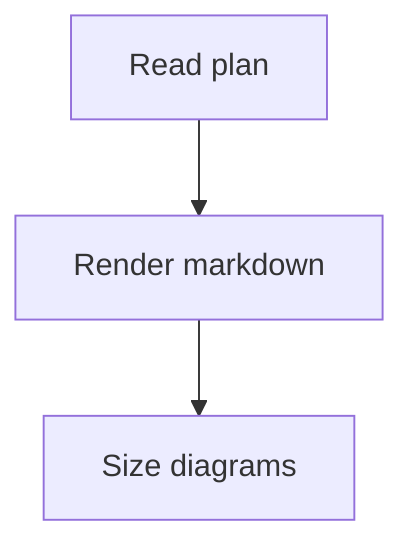
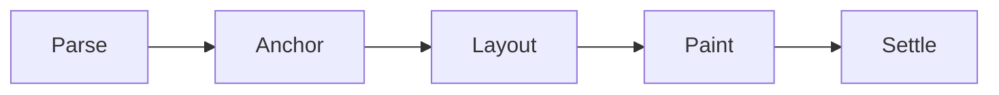
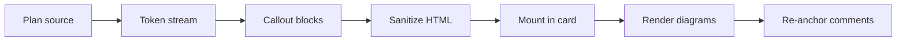
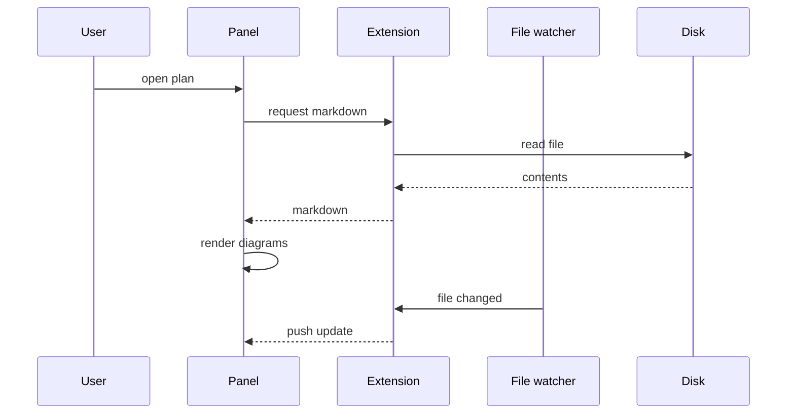
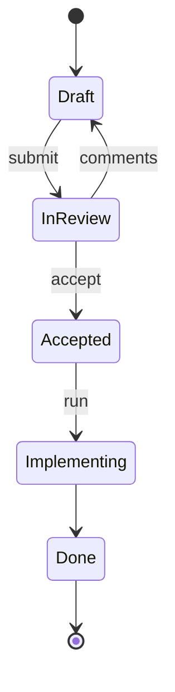
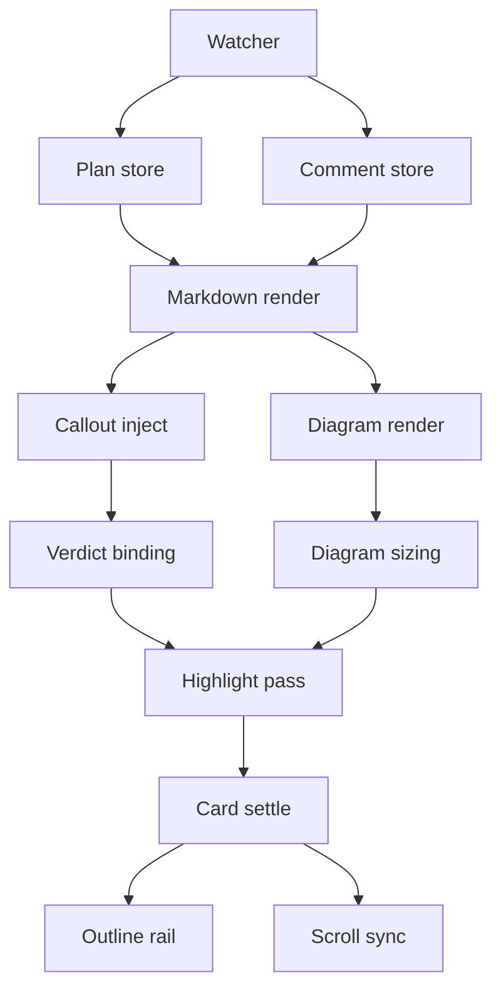

# Fixture: diagram sizing under every width regime

## Context

Depth: Standard

This is a **fixture**, not a sample and not work to implement. Its job is to
fail visibly when diagram sizing regresses. Each phase carries one diagram
chosen to sit in a different width regime relative to the ~680px document
column, so opening this plan in the Waypoint panel exercises every branch of
`fitDiagram` (`src/webview/lib/diagram.ts`) at once.

The three regimes, in the order `fitDiagram` tests them: natural width already
inside the column (render at natural size, centred); wider than the column but
scaling to fit stays at or above `MIN_SCALE` (fit, mild shrink, still centred);
wider than the floor allows (hold `naturalW * MIN_SCALE` and scroll, left
aligned).

:::assumption
Rendered widths are approximate and font-dependent — a diagram described here
as "borderline" may land either side of the floor on a different platform. What
the fixture guarantees is *coverage of the regimes*, not exact pixel values:
across the six diagrams, at least one must scroll and at least one must render
untouched at natural size.
:::

:::note
Distinct from `.waypoint/plans/sample-mermaid-showcase.md`, which is a content
sample demonstrating what a diagram is *for*. This file exists only to stress
sizing, so its diagrams are deliberately dull.
:::

## Phase 1: Narrow — fits the column untouched

Three nodes, short labels. Comfortably inside the column at any card width, so
`fitDiagram` returns natural width with no scroll and the SVG is centred. This
is the regime where the 18px base font is most visible: nothing is scaled down,
so the node text should read *larger* than the paragraph you are reading now.

### Phase 1 acceptance gate

:::checklist
- [ ] @human The three node labels are visibly larger than this sentence's body text.
- [ ] @human The diagram is horizontally centred in the card and has no scrollbar.
:::

## Phase 2: Borderline — shrinks slightly, still inside the floor

Five nodes left-to-right with medium labels: wide enough to overflow a default
card, but not by enough to cross the 0.85 floor. Expected treatment is a mild
downscale to exactly the column width — still centred, still no scrollbar. This
is the case #D2 exists for: shrinking 5–10% is invisible, forcing a scrollbar
would not be.

### Phase 2 acceptance gate

:::checklist
- [ ] @human At the default card width this diagram fills the column edge to edge with no scrollbar.
- [ ] @human Its label text is still no smaller than the body text beside it.
:::

## Phase 3: Wide LR chain — past the floor, scrolls

The screenshot case: a seven-node left-to-right chain with real labels. Under
the old fit-to-column rule this was scaled to roughly half the body text size.
Now it holds the floor and scrolls horizontally inside the figure — and because
a centred overflowing scroll container clips its *left* edge, the figure flips
to left-aligned when it scrolls.

### Phase 3 acceptance gate

:::checklist
- [ ] @human The figure scrolls horizontally rather than shrinking to fit.
- [ ] @human The first node is flush with the left edge of the diagram area — nothing is clipped off the left.
- [ ] @human Scrolling to the right reveals the final node in full.
:::

## Phase 4: Sequence diagram — a non-flowchart type

The fit rule reads `viewBox` rather than per-type config (#D1), so it must work
on a diagram type whose layout engine is entirely different. Five participants
put this in the overflow regime.

### Phase 4 acceptance gate

:::checklist
- [ ] @human The sequence diagram is sized by the same rule — either fitted or scrolling, never shrunk below the body text size.
:::

## Phase 5: State machine — tall rather than wide

A state diagram is the opposite stress: it grows vertically, so natural width
stays inside the column. It must render at natural size and must *not* be
stretched up to the column width — `fitDiagram` returns `naturalW`, not `colW`,
when the diagram already fits.

### Phase 5 acceptance gate

:::checklist
- [ ] @human The state diagram renders at its natural size, centred, not stretched to the full column width.
:::

## Phase 6: Twelve-node graph — the worst case

The upper bound the skill's guidance names. Even at the floor this is a scroll
box in a 680px column — the hardest case for the claim that the floor alone is
enough, which is why the zoom overlay was cut only after this phase rendered
legibly.

### Phase 6 acceptance gate

:::checklist
- [ ] @human Every node label in the twelve-node graph is legible without zooming the whole panel.
:::

## Verification

Open this plan in the Waypoint panel (**Waypoint: Open Plan Viewer**) after
`./reload.sh` and a window reload — per `CLAUDE.md` the installed extension
serves the old bundle until reinstalled.

1. Walk the six phases top to bottom: no diagram's text is smaller than the
   prose beside it, and no diagram is clipped at its left edge.
2. Drag the card from 560px to 920px and back. Diagrams re-fit live without a
   reload; a diagram that scrolled at 560px may stop scrolling at 920px.
3. Toggle the theme. Diagrams re-render and keep their sizing.
